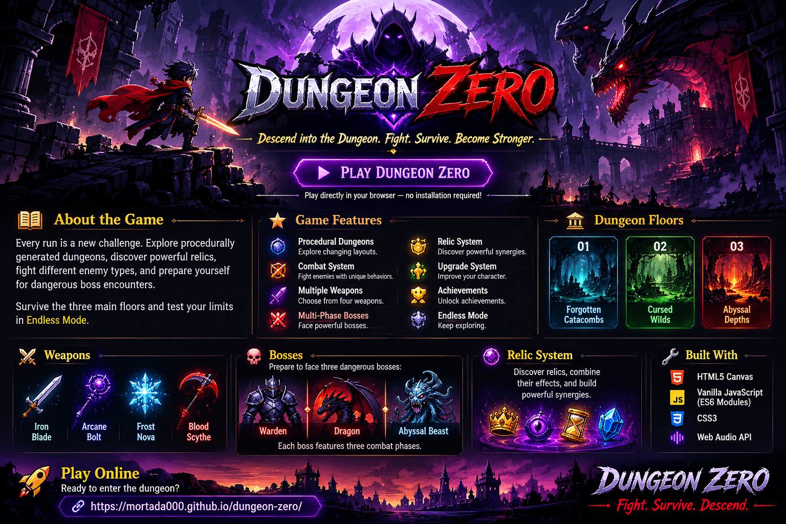

⚔️ DUNGEON ZERO

🩸 Descend into the dungeon. Fight. Survive. Become stronger.

A dark 2D roguelike dungeon crawler built with HTML5 Canvas and Vanilla JavaScript.

Explore dangerous floors, battle deadly enemies, defeat powerful multi-phase bosses, collect mysterious relics, and build your ultimate fighter.

  <a href="https://mortada000.github.io/dungeon-zero/">
    <strong>🎮 PLAY DUNGEON ZERO</strong>
  </a>

---

🏰 About the Game

Every run is a new challenge.

Explore procedurally generated dungeons, face increasingly dangerous enemies, discover powerful relics, and prepare yourself for brutal boss encounters.

Survive all three main floors and test your limits in Endless Mode.

✨ Game Features

- 🗺️ Procedural Dungeons — Explore changing dungeon layouts.
- ⚔️ Combat System — Fight enemies with different behaviors and attacks.
- 🗡️ Multiple Weapons — Iron Blade, Arcane Bolt, Frost Nova, and Blood Scythe.
- 👹 Multi-Phase Bosses — Face challenging bosses with three combat phases.
- 💎 Relic System — Collect powerful relics and discover unique synergies.
- 📈 Upgrade System — Become stronger throughout each run.
- 🏆 Achievements — Complete challenges and earn rewards.
- ♾️ Endless Mode — Keep fighting beyond the main floors.

🌑 Dungeon Floors

Floor| Dungeon Theme
01| 🏚️ Forgotten Catacombs
02| 🌲 Cursed Wilds
03| 🔥 Abyssal Depths

⚔️ Weapons

Weapon| Type
🗡️ Iron Blade| Melee
🔮 Arcane Bolt| Magic
❄️ Frost Nova| Frost
🩸 Blood Scythe| Dark

👑 Bosses

- 🛡️ Warden
- 🐉 Dragon
- 🌊 Abyssal Beast

Each boss features three combat phases.

## 📸 Screenshots

### 🎮 Gameplay

### ⚔️ Dungeon Screenshots

🚀 Play Online

Ready to enter the dungeon?

👉 "PLAY DUNGEON ZERO" (https://mortada000.github.io/dungeon-zero/)

No installation required.

🛠️ Built With

- 🌐 HTML5 Canvas
- ⚡ Vanilla JavaScript (ES6 Modules)
- 🎨 CSS3
- 🔊 Web Audio API

---

  <strong>⚔️ DUNGEON ZERO ⚔️</strong> 
  <em>Fight. Survive. Descend.</em>

